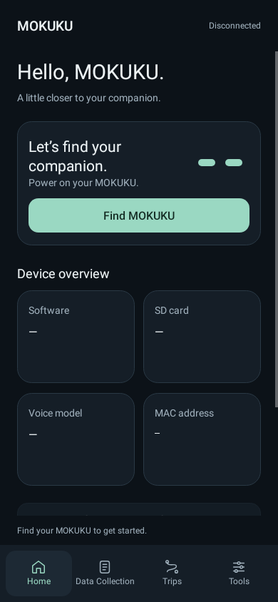
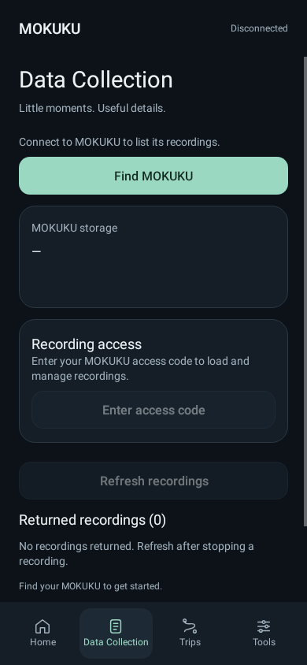

# MOKUKU Android Native

A calm, dark Android companion for the original two-eye ESP32-S3 MOKUKU and the
single-ESP32-S31 MOKUKU II. Connect over Bluetooth LE to inspect device information, download and manage recordings,
sync trips and see them on a map, try eye interactions, and send update or debug commands.

Four tabs keep the app easy to explore: **Home**, **Data Collection**, **Trips**,
and **Tools**, where Updates and Debug live. Muted mint accents,
soft slate cards, and generous spacing follow the approved companion design.

| Home | Data Collection |
|---|---|
|  |  |

Native Android renders show the disconnected state; device values populate after
connection. See [Tools](design/previews/native-tools.png),
[Updates](design/previews/native-updates.png), [Trips](design/previews/native-trips.png)
and a [trip](design/previews/native-trip.png) (sample trips, map tiles not loaded), and the
[access-code dialog](design/previews/native-access-code.png) for more screens.

The app uses native Java/XML and the Gradle structure of `MobiliAndroidHUD`.
It picks the protocol from the advertised name: `mokuku_*` is the original MOKUKU,
`mokukuii*` is MOKUKU II. Each screen shows only the actions that device supports;
see [MOKUKU II](#mokuku-ii).

## Use the app

- **Home:** find/connect to a `mokuku_` device, then query both eyes' firmware
  versions, SD free/total space, voice model, and MAC address. Allow Nearby devices
  permission on Android 12+, or location permission/services on Android 6–11.
- **Simulation:** send left/right clicks or toggle eye mode from Home, and set the
  speed, RPM, and fuel shown on the panels. OBD or GPS data can replace them.
- **Tools → Updates:** save Wi-Fi and the remote URL independently; the app
  refills the last saved values on its next launch. Request
  firmware OTA, voice-model OTA, meme updates, or per-eye rollback. Complete the
  right-eye update before confirming a left-eye update. Right-eye requests keep the
  connection, since the left eye relays them; left-eye and voice requests disconnect.
  Refresh versions after the device finishes; command acceptance is not update completion.
  **Update both eyes** requests the right eye, then the left eye 500 ms later; the
  app then reconnects for up to 5 minutes and refreshes versions once MOKUKU is back.
- **Tools → Debug:** request OBD on/off, enable debug logging, set date/time, and
  start/stop recording. The firmware does not report OBD, mode, or recording state.
- **Data Collection:** refresh returned recordings, download one at a time,
  delete a file, or clear device recordings. Enter the device access code in
  **Recording access** first. Deletion first requests recording stop.
  Downloads show byte progress, average speed, and approximate time remaining
  after an initial estimation period.
  **Download to phone** saves the complete file to the phone's `Download/MOKUKU`
  folder, renamed by Android if the name is taken; Android 9 and older first ask for
  storage access. Recordings are named by their start time (`YYYYMMDD_HHMMSS.rec`).
  Device deletion keeps phone copies. Cancel/disconnect discards only an unfinished
  download; start it again to retry.
- **Trips:** **Sync trips** downloads the connected MOKUKU's trips
  ([format](../doc/TRIP_RECORDING.md) in MobiliMOKUKU) that the phone lacks, and the
  rest of the phone's newest trip from it, which MOKUKU may still have been recording.
  Trips stay in app-private storage, grouped by BLE address, with the connected
  MOKUKU first. Open a trip to see its route on an OpenStreetMap map, colored by speed (OBD, or GPS
  without it), with distance,
  duration, speeds, harsh acceleration, braking, and turn counts, and a driving style
  (Smooth, Sporty, Aggressive, or Eco). **Delete older trips on MOKUKU** syncs, then deletes every
  trip on MOKUKU's SD card except the latest; nothing is deleted if any trip fails to
  sync. **Delete from phone** on a trip, or **Delete N trips from phone** under a
  device, removes phone copies, also while disconnected; trips still on MOKUKU download
  again on the next sync. The original MOKUKU needs the recording access code. See
  [Trips](#trips) for sync limits.

The phone sends commands over BLE; MOKUKU itself downloads OTA assets over its
configured Wi-Fi. The app uses the internet only for OpenStreetMap tiles, cached in
app storage, and needs no broad storage permission. Date/time
sends the chosen wall-clock fields in the firmware's shared calendar/clock basis;
GPS can override its debug date. This behavior needs confirmation on hardware.

The original firmware can omit filenames from a long directory response, and an
empty result can also mean the directory could not be opened. The app reports
**No recordings returned after clearing**, rather than promising every file was
deleted. A listing too long for one notification gets no reply; the app stays connected
and says so (Trips then finds trips by number, see [Trips](#trips)). Hardware
validation is still required for BLE, date/time, OTA, and SD operations.

Device information and the returned recording list are cleared on disconnect;
downloaded phone copies remain available.

## Trips

Sync behavior to know:

- **Long trip listings on the original MOKUKU.** Its firmware drops a directory reply that
  does not fit one notification (MTU − 3 bytes, about 40 trip names), so the listing gets
  no reply at all. The app treats the silence as "too many to list", keeps the connection,
  and probes `trip_<n+1>.bin`, `trip_<n+2>.bin`, … above the newest phone trip until
  MOKUKU reports one missing. MOKUKU II lists in pages and is unaffected.
- **Reused trip numbers.** MOKUKU numbers trips from an NVS counter; erasing NVS (or a full
  flash erase) restarts the numbers. When a device trip's first bytes do not match the
  phone copy of the same name, the app keeps the phone copy and reports the difference.
  A phone holding a higher-numbered trip from before the erase will not fetch the
  device's new, lower-numbered trips until the device's numbers pass it.
- **Internet.** The app uses the internet only for OpenStreetMap map tiles, through
  osmdroid, cached in app storage; routes draw without them.

## Download performance

During a download the app requests Android's high connection priority and restores
balanced priority when it finishes, fails, or is canceled. It downloads over the
File Command and File Data characteristics: MOKUKU streams CRC-checked sectors of
up to 16 KB and waits for the app to acknowledge each one. The app asks for a
sector again after a CRC failure, a missing packet, or 3 s without data, and stops
after three failed attempts. Downloads need firmware with this sector transfer.

The app requests MTU 517. For a slow transfer, capture
`adb logcat -s MokukuBluetooth:I`. It reports the negotiated MTU, sector size,
resent sectors, and the final result, without logging access codes.

## Recording access

Connect, open **Data Collection → Enter access code**, and choose **Use code** to
load recordings. Input is masked with an optional reveal control. The app saves
the code privately on this phone for that device's BLE address and reuses it after
reconnecting or restarting the app. Codes are excluded from backup/device transfer
and are not compiled into the APK.
Use **Change access code** to replace it, or **Forget access code** to remove the
saved code, including while disconnected. Forgetting keeps downloaded phone copies.
The firmware does not acknowledge code
acceptance; a wrong code can make file requests time out. No Actions secret or
special build configuration is needed.

## MOKUKU II

MOKUKU II uses the set/get protocol in MobiliMOKUKU's `doc/MOKUKU_II_BLE_CONTROL.md`.
Compared with the original MOKUKU:

- **Home:** one firmware version; voice model shows the wake word and command language.
- **Simulation:** next left/right panel and meme/data mode switch.
- **Updates:** Wi-Fi and remote address come last and are limited to 64 bytes each. **Choose
  firmware image** sends a MOKUKU II app image (`IDF_MOKUKU_II_prototype.bin`) over
  BLE; MOKUKU II checks it and restarts into it, and canceling restarts it into its
  current firmware. The firmware card lists both OTA slots. Voice commands switch
  between English and Mandarin, restarting MOKUKU II when the language changes.
  **Roll back firmware** restarts into the other slot when it is older. There are no
  meme updates.
- **Debug:** OBD on/off with its current state. Debug log, date/time, and
  recording start/stop are not on BLE; start and stop recordings by voice.
- **Trips:** no access code; the trip listing is complete (paged).
- **Data Collection:** no access code. The list is complete (paged), and
  **Clear all recordings** deletes in one request, refused while recording. There is
  no per-file delete.

The app sends a version query after 10 s without other writes, because MOKUKU II
disconnects a host idle for 30 s. Replies longer than one notification are not read
back; the app requests MTU 517 so they fit. Hardware verification is pending.

## App design

The [first design proposal](design/README.md) covers the original two-eye MOKUKU:
four tabs: Home (with Simulation), Data Collection, Trips (with a trip map), and Tools
(with Updates and Debug).
Open [the interactive prototype](design/index.html) in a browser to review the
dark charcoal and mint style. Every device value and interaction in it is sample
data; it uses no Bluetooth or network access. The native implementation uses real
device responses; the browser prototype remains a design reference.

## Build

Use JDK 17 and an Android SDK with these packages:

```bash
sdkmanager "platform-tools" "platforms;android-35" "build-tools;35.0.0"
sdkmanager --licenses
export ANDROID_HOME=/path/to/android-sdk
./scripts/build.sh
```

The script builds, runs protocol/native UI checks, and lints the debug app, then
exports `output/mokuku-debug.apk`.
To install it on a connected, authorized device or running emulator:

```bash
./scripts/build.sh --install
```

Open this directory in Android Studio to import the project. On Windows, use
`gradlew.bat :app:assembleDebug :app:testDebugUnitTest :app:lintDebug`; the APK is at
`app/build/outputs/apk/debug/app-debug.apk`.

The application ID is `com.mokuku.debug`; minimum Android version is 6.0 (API 23).
Builds use Android SDK 35, [Android Gradle Plugin 8.13.2](https://developer.android.com/build/releases/agp-8-13-0-release-notes),
and Gradle 8.13 through the checked-in wrapper with its
[distribution checksum](https://gradle.org/release-checksums/).
Debug signing uses the local Android debug keystore generated by Gradle.

## Container build

```bash
docker build -f artifacts/docker/dev.dockerfile -t mokuku-android-dev .
docker run --rm -v "$PWD:/repository" mokuku-android-dev ./scripts/build.sh
```

The image installs JDK 17 and Android SDK 35 from public sources. Container builds
write the APK to the same `output/` directory on the host.

## Repository layout

| Path | Purpose |
|---|---|
| `AGENTS.md` | Repository scope, design conventions, build checks, and contributor workflow for coding agents. |
| `app/` | Native Android application: manifest, Java activity, XML resources. |
| `app/src/main/java/com/mokuku/debug/` | Native UI (`MainActivity`, `Ui`), serialized BLE session/file operations (`MokukuConnection`), byte framing/validation (`MokukuProtocol`), and trip parsing/storage (`TripLog`, `TripStore`). |
| `app/src/test/` | Protocol fixtures and native navigation/lifecycle checks with Robolectric. |
| `design/` | Visual style, screen flows, protocol map, and interactive prototype. |
| `gradle/`, `gradlew`, `gradlew.bat` | Gradle wrapper for Linux, macOS, and Windows. |
| `scripts/build.sh` | Build, test, lint, export, and optionally install the debug APK. |
| `artifacts/docker/dev.dockerfile` | Android build environment. |
| `.github/workflows/android.yml` | GitHub Actions build, tests, lint, and APK artifact upload. |

GitHub Actions runs `scripts/build.sh` for pushes to `main`/`master` and pull requests that
change `app/`, the Gradle build files/wrapper, the build helper, or the APK workflow
itself. Markdown and changes confined to documentation or `design/` do not trigger
an APK build. Manual runs remain available. Robolectric's Android SDK jars are cached
between runs, keyed on `app/build.gradle`. Successful builds upload
`mokuku-debug.apk` as a workflow artifact. The shared
[path filter](https://docs.github.com/en/actions/reference/workflows-and-actions/workflow-syntax#onpushpull_requestpull_request_targetpathspaths-ignore)
keeps push and PR triggers consistent.

See `doc/BLE_CONTROL.md` and `doc/MOKUKU_II_BLE_CONTROL.md` in the parent
`MobiliMOKUKU` repository and the checked [protocol map](design/PROTOCOL_MAP.md).
