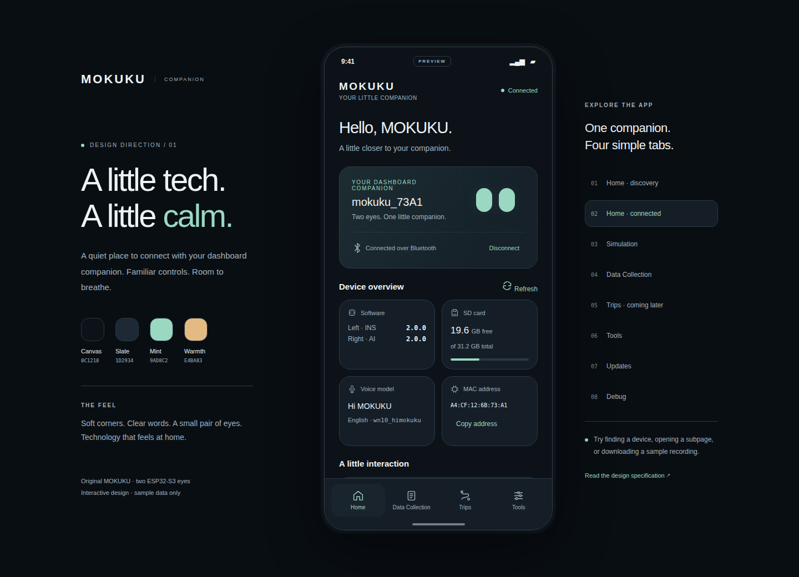

# MOKUKU companion app design

PR #1 establishes the visual style and screen flows for the original two-eye
ESP32-S3 MOKUKU. It contains an interactive browser prototype with sample data.
The native Android app implements these flows for the original MOKUKU and, where
MOKUKU II supports them, for MOKUKU II (see the root README); the browser prototype
remains a sample-data design reference for the original MOKUKU.

Open `index.html` directly in a browser; no server, dependencies, or internet access
are needed. The desktop controls jump between screens and connection states.
Inside the phone, use the tabs, Home/Tools shortcuts, and back buttons. Scan, connect,
download, update, and debug interactions are demonstrations only.



Screen previews: [Home](previews/home.png), [Data Collection](previews/data-collection.png),
[Tools](previews/tools.png), [Updates](previews/updates.png),
[Debug](previews/debug.png), [Simulation](previews/simulation.png),
[Trips](previews/trips.png), [Trips sync](previews/trips-sync.png), and [Trip map](previews/trip.png).

Native Android previews, rendered with Robolectric in the disconnected state:
[Home](previews/native-home.png), [320 dp Home](previews/native-home-small.png),
[Tools](previews/native-tools.png), [Updates](previews/native-updates.png),
[Data Collection](previews/native-records.png), and [320 dp Data Collection](previews/native-records-small.png).
Blank access-code dialogs: [390 dp](previews/native-access-code.png),
[320 dp](previews/native-access-code-small.png).
Sample trips: [Trips](previews/native-trips.png), [sync](previews/native-trips-sync.png), and
[trip](previews/native-trip.png), whose map shows no tiles because tests have no network.
Sample download-progress previews: [390 dp](previews/native-download.png),
[320 dp](previews/native-download-small.png). These use simulated transfer values.
All native previews validate layout only; they do not demonstrate a hardware connection.

## Direction: quiet technology

Make MOKUKU feel like a companion, with a small pair of expressive eyes and a clear
connection state. Use a deep charcoal canvas, soft slate surfaces, and muted mint
for the next action. Space and type establish hierarchy; avoid dense dashboards,
neon outlines, decorative telemetry, and continuous motion.

| Token | Value | Use |
|---|---|---|
| Canvas | `#0C1218` | App background |
| Surface | `#151E27` | Cards and bottom navigation |
| Raised surface | `#1D2934` | Fields, icon backgrounds, pressed states |
| Border | `#2A3945` | Quiet separation |
| Primary text | `#EDF3F5` | Titles and values |
| Secondary text | `#A2B2BE` | Supporting text |
| Accent | `#9AD8C2` | Primary action and selected tab |
| Accent ink | `#10271F` | Text on mint buttons |
| Warm accent | `#E4BA83` | Update and attention states |
| Destructive | `#F0A19B` | Delete and rollback actions |

Use Android's system sans serif. Titles are 28–32 sp, card titles 18 sp, body and
controls 16 sp, supporting text 14 sp, and compact labels 12 sp. Reserve monospace
for MAC addresses, filenames, and version values. Support system font scaling;
rows grow vertically rather than truncating important information.

Use 24 dp screen gutters, 16 dp card padding, 12–16 dp gaps, 24 dp section gaps,
20 dp card corners, and 14 dp field/button corners. Touch targets are at least
48 × 48 dp. All icons have text labels or accessible names. Status always has a
word as well as a color. Respect system bars, the keyboard, reduced motion, and
small displays. Use 160–220 ms transitions; no blinking recording indicator.

## Navigation

```text
Home                    Data Collection          Trips                Tools
├── Find / connect      ├── Device recordings     ├── Sync trips       ├── Updates
├── Device information  ├── Download / cancel     ├── Trips by device  └── Debug
└── Simulation          └── Delete / clear all /  └── Trip → map
                            confirm
```

Keep four labeled bottom tabs: **Home**, **Data Collection**, **Trips**, and
**Tools**. Simulation returns to Home; Trip returns to Trips; Updates and Debug return to Tools. Subpages
use a back arrow and hide the bottom tabs, preserving their parent's scroll position
on return. Android Back closes the current sheet or confirmation first, then the
subpage, then returns to Home from another tab.

## Home

Start disconnected with a welcoming device card and one primary action: **Find
MOKUKU**. Show Bluetooth-off, permission-needed, scanning, empty-result, and
connection-failed states in this area with a relevant retry action. Do not request
permissions until the user starts discovery. Show device name, MAC address, and
signal strength in scan results; select a device to connect. Original MOKUKU
(`mokuku_*`) and MOKUKU II (`mokukuii*`) devices are eligible; the name selects the protocol.

On connection, replace the discovery card with the device name and **Connected**
status. Query information automatically and provide **Refresh**. Show placeholders
while each query runs; a failed query gets **Unavailable** and its own retry rather
than clearing successful results.

Show firmware versions for **Left eye · INS** and **Right eye · AI**, SD free/total
space, voice model/language, and the device MAC address. MAC supports copy.
Meme versions may appear under Updates. Avoid a generic “healthy” or “up to date”
claim: these cannot be inferred from a successful BLE connection or version query.

Place a **Simulation** shortcut below the overview. **Tools**, the fourth tab,
contains spacious **Updates** and **Debug** shortcuts. On disconnect, disable device
actions and clear device values, query errors, and returned filenames. Keep the saved
locations of this session's downloads.

## Tools → Updates

Use separate **Wi-Fi** and **Remote URL** cards above the update actions. Wi-Fi
contains the network name, password, and **Save Wi-Fi** button; Remote URL contains
the base URL and its own **Save remote URL** button. Each form validates and saves
independently, so changing the URL does not require re-entering Wi-Fi credentials.
Password is masked, has a reveal control, is never logged, and is not
prefilled from a device query. These settings are write-only in the original
protocol. Label fields as entries to send, and show each save result independently;
Wi-Fi succeeds only after both name and password writes are acknowledged. Report
either field's failure without implying both were saved. The URL has its own
acknowledgement. Never call an unacknowledged write “saved.” Validate UTF-8 byte lengths against the
firmware's buffers, not just the protocol's 255-byte envelope.

Use separate cards for **Firmware OTA**, **Voice model**, **Meme assets**, and
**Rollback**. Each per-eye action names its target explicitly. Firmware and meme
updates guide the user through **Right eye first, then left eye**. Firmware also
offers **Update both eyes**: right-eye request, left-eye request 500 ms later, then
automatic reconnection for up to 5 minutes while the left eye updates. Voice OTA offers English and Mandarin,
and explains that it updates the right-eye model and both eyes' wake-word assets.

Confirm the action and target before sending a rebooting operation. After command
acknowledgement, say **Update requested**. The connected left eye relays right-eye
requests over UART, so only left-eye and voice requests disconnect; there is no
live OTA progress query. Query versions after the device finishes to verify the
result. Rollback requires a separate confirmation naming the eye.

## Simulation

Use a pair of eye-shaped buttons labeled **Left click** and **Right click**. A
separate **Change eye mode** button sends the device's toggle command. Since the
protocol does not report its current mode, do not display a persistent mode switch
or mark a mode as confirmed. Give brief **Command sent** feedback after each action.

## Tools → Debug

Use grouped actions: **Enable OBD / Disable OBD**, **Enable debug log**, **Set
date & time**, and **Start recording / Stop recording**. OBD and recording have
no state query, so report the last command sent instead of inventing a synchronized
switch state. Debug logging has an enable command only; do not offer disable.

Date/time uses a picker with **Use phone time** as a shortcut and confirms the
selected value before sending. The firmware can override debug dates when GPS has
a fix. Recording feedback links to Data Collection, where the file list can be
refreshed after stopping. Command acknowledgement alone does not verify that a
recording file was created.

## Data Collection

Place a **Recording access** card above the file controls. **Enter access code**
opens a masked dialog with optional reveal and **Use code** / **Cancel** actions.
Using a code saves it privately for this device's BLE address and refreshes
recordings. Show that the code is saved without claiming authentication succeeded.
Reuse it after reconnect or app restart. **Change access code** opens a blank field;
**Forget access code** removes only this device's saved code and keeps downloaded
copies. Allow forgetting while disconnected; disable it during an operation.
Exclude saved codes from backup and device transfer.
Never include entered codes in previews. The browser prototype remains a sample-data
reference; this access dialog is implemented in the native app.

Show SD free/total space, **Refresh**, and the filenames returned from
`/sd/record`. The directory API returns names only: do not invent recording dates,
durations, distances, or file sizes. Numeric recording IDs can be sorted in
descending order without calling that “newest by date.”

Each row has **Download** and an accessible overflow menu containing **Delete from
MOKUKU**. Confirm deletion with the full filename and distinguish the device copy
from a downloaded phone copy. Refresh after deletion to check that the name is gone.

Provide **Clear all recordings** below the list. Its confirmation explains that
all device recordings, including files not downloaded, will be removed; phone copies
are kept. Ask the user to stop recording first. Disable clear-all while a download
is active. Delete the returned filenames, then query and repeat until no recordings
are returned. Stop and report a failure if a pass makes no progress. The current
firmware also returns an empty listing when opening the directory fails; use
**No recordings returned after clearing**, rather than claiming definitive deletion
of every file. Deleting only the initial, potentially partial listing is insufficient.

Download one file at a time. Show received/total bytes and progress once the file
open reply supplies its size. Below the byte count, show average payload speed in
B/s, KiB/s, or MiB/s and approximate time remaining. Use elapsed monotonic time from
the first read request; show **Estimating speed and time remaining…** until at least
one second has elapsed and data has arrived. Reset estimates for each download;
rotation preserves the current transfer. A completed file is saved straight to the phone's
`Download/MOKUKU` folder; only then show **Saved to** with its location. Cancellation or
disconnect leaves the file retryable and must not label a partial file as complete.

Handle disconnected, loading, no recordings, authorization failure, directory
failure, download failure, delete failure, and partially completed clear-all
separately. Keep the list refreshable after an interrupted clear-all. The directory response
can be truncated by the firmware; label it **Returned recordings**, rather than
claiming the list is complete when that cannot be verified.

## Trips

Trips are the drives MOKUKU records to its SD card
([trip format](../../doc/TRIP_RECORDING.md) in MobiliMOKUKU). The phone keeps its own copies
in app-private storage, so the Trips tab works offline and while disconnected.

Place a sync card first. Connected, it names the device and offers **Sync trips**, which
downloads every trip on MOKUKU that the phone does not have, plus the rest of the newest phone
trip in case MOKUKU was still recording it. Syncing never deletes device or phone trips.
Below it, **Delete older trips on MOKUKU** (destructive style) confirms, syncs, then deletes
every trip on MOKUKU except the latest by number range; phone copies stay, and nothing is
deleted if any trip fails to sync. Disconnected, the card says **Connect to download new trips**
and disables both buttons. The
original MOKUKU needs the Data Collection access code; without one, **Sync trips** opens the
access-code dialog. While syncing, show **Trip 2 of 5** with the device filename, the
download progress, and **Cancel**; trips already saved stay. Finish with how many trips were
added, or that the phone already has every trip.

Connected, a **Trip recording** card follows with the state MOKUKU reports (**On**, **Off**, or
**Unavailable** on older firmware) and one button, **Turn on trip recording** or **Turn off trip
recording**. MOKUKU saves the setting and starts with it off.

Below, group the phone's trips by device: a heading with the device name, trip count, and BLE
address in monospace, then the trips newest first. The connected MOKUKU's group comes first,
tinted mint with a **Connected** label; other devices follow by their newest trip. Each row is a button with a small route
thumbnail, the local start date and time, and distance · duration. Each group ends with
**Delete N trips from phone** (destructive style), which confirms and removes that device's
phone copies; it works disconnected but not during a sync. With no trips, show the
empty state: **No trips on this phone yet**.

Opening a trip shows the **Trip** subpage: the start date as the title, the start time and
device below it, then the route drawn on an OpenStreetMap map, fitted to the trip, with a mint
start ring and a warm end dot and a **Start** / **End** legend. The map pans and zooms and shows
the OpenStreetMap attribution; without internet the route still draws over blank tiles. Below
the map, a two-column grid shows distance, duration, average speed, and top GPS speed, then the
source filename and **Delete from phone**, which confirms, deletes the phone copy, and returns
to Trips. A deleted trip still on MOKUKU downloads again on the next sync. Draw the route only from records whose CRC passes; a trip cut short by power
loss ends at its last good record.

## Implementation after design review

1. Apply the approved tokens and native navigation; preserve system Back, insets,
   accessibility labels, font scaling, and screen state across rotation.
2. Add original-MOKUKU discovery, connection, notification subscription, and queued
   writes; query Home information after subscription succeeds.
3. Implement controls and file transfer using [the protocol map](PROTOCOL_MAP.md),
   with real timeout, disconnect, and retry states.
4. Implement Trips: sync over the shared file transfer, app-private storage per device,
   and the trip map.

Review the screenshot and prototype for hierarchy, spacing, labels, and screen
flows. Visual sample data is not a source of protocol values or device behavior.
