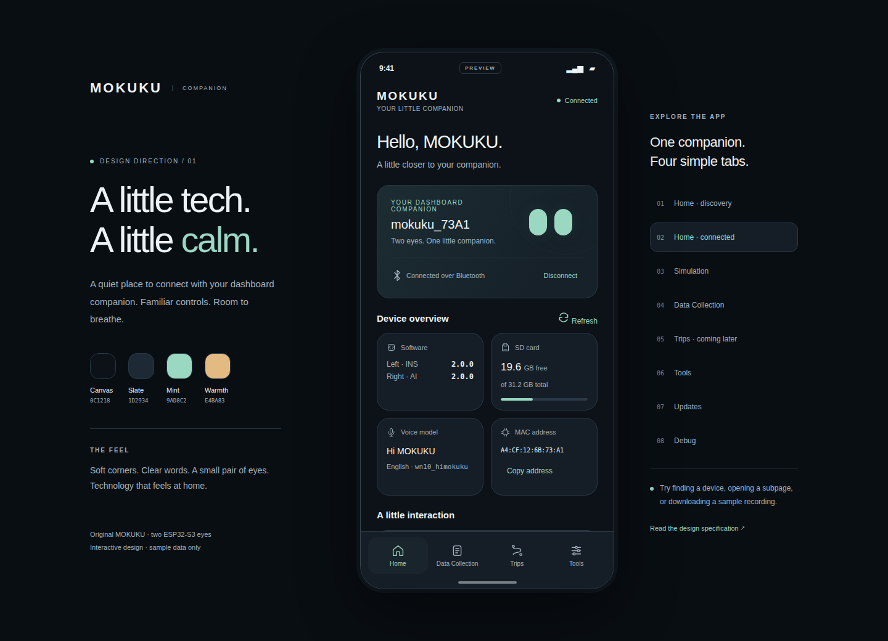

# MOKUKU companion app design

PR #1 establishes the visual style and screen flows for the original two-eye
ESP32-S3 MOKUKU. It contains an interactive browser prototype with sample data.
The Android starter app remains the buildable base for implementation after design review.

Open `index.html` directly in a browser; no server, dependencies, or internet access
are needed. The desktop controls jump between screens and connection states.
Inside the phone, use the tabs, Home/Tools shortcuts, and back buttons. Scan, connect,
download, update, and debug interactions are demonstrations only.



Screen previews: [Home](previews/home.png), [Data Collection](previews/data-collection.png),
[Tools](previews/tools.png), [Updates](previews/updates.png),
[Debug](previews/debug.png), [Simulation](previews/simulation.png),
and [Trips](previews/trips.png).

## Direction: quiet technology

Make MOKUKU feel like a companion, with a small pair of expressive eyes and a clear
connection state. Use a deep charcoal canvas, soft slate surfaces, and muted mint
for the next action. Space and type establish hierarchy; avoid dense dashboards,
neon outlines, decorative telemetry, and continuous motion.

| Token | Value | Use |
|---|---|---|
| Canvas | `#0C1218` | App background |
| Surface | `#151E27` | Cards and bottom navigation |
| Raised surface | `#1D2934` | Fields, icon backgrounds, pressed states |
| Border | `#2A3945` | Quiet separation |
| Primary text | `#EDF3F5` | Titles and values |
| Secondary text | `#A2B2BE` | Supporting text |
| Accent | `#9AD8C2` | Primary action and selected tab |
| Accent ink | `#10271F` | Text on mint buttons |
| Warm accent | `#E4BA83` | Update and attention states |
| Destructive | `#F0A19B` | Delete and rollback actions |

Use Android's system sans serif. Titles are 28–32 sp, card titles 18 sp, body and
controls 16 sp, supporting text 14 sp, and compact labels 12 sp. Reserve monospace
for MAC addresses, filenames, and version values. Support system font scaling;
rows grow vertically rather than truncating important information.

Use 24 dp screen gutters, 16 dp card padding, 12–16 dp gaps, 24 dp section gaps,
20 dp card corners, and 14 dp field/button corners. Touch targets are at least
48 × 48 dp. All icons have text labels or accessible names. Status always has a
word as well as a color. Respect system bars, the keyboard, reduced motion, and
small displays. Use 160–220 ms transitions; no blinking recording indicator.

## Navigation

```text
Home                    Data Collection          Trips             Tools
├── Find / connect      ├── Device recordings     └── Coming later   ├── Updates
├── Device information  ├── Download / cancel                       └── Debug
└── Simulation          └── Delete / clear all / confirm
```

Keep four labeled bottom tabs: **Home**, **Data Collection**, **Trips**, and
**Tools**. Simulation returns to Home; Updates and Debug return to Tools. Subpages
use a back arrow and hide the bottom tabs, preserving their parent's scroll position
on return. Android Back closes the current sheet or confirmation first, then the
subpage, then returns to Home from another tab. The Trips tab has a restrained
empty state; it contains no invented trips.

## Home

Start disconnected with a welcoming device card and one primary action: **Find
MOKUKU**. Show Bluetooth-off, permission-needed, scanning, empty-result, and
connection-failed states in this area with a relevant retry action. Do not request
permissions until the user starts discovery. Show device name, MAC address, and
signal strength in scan results; select a device to connect. Only original MOKUKU
devices are eligible; the implementation must exclude MOKUKU II advertisements.

On connection, replace the discovery card with the device name and **Connected**
status. Query information automatically and provide **Refresh**. Show placeholders
while each query runs; a failed query gets **Unavailable** and its own retry rather
than clearing successful results.

Show firmware versions for **Left eye · INS** and **Right eye · AI**, SD free/total
space, voice model/language, and the device MAC address. MAC supports copy.
Meme versions may appear under Updates. Avoid a generic “healthy” or “up to date”
claim: these cannot be inferred from a successful BLE connection or version query.

Place a **Simulation** shortcut below the overview. **Tools**, the fourth tab,
contains spacious **Updates** and **Debug** shortcuts. Device actions become unavailable after disconnect; cached values
remain visible with **Last received** labeling until a new query succeeds.

## Tools → Updates

Group **Wi-Fi name**, **Wi-Fi password**, and **Remote base URL** above the update
actions. Password is masked, has a reveal control, is never logged, and is not
prefilled from a device query. These settings are write-only in the original
protocol. Label fields as entries to send, and show each save result independently;
never call an unacknowledged write “saved.” Validate UTF-8 byte lengths against the
firmware's buffers, not just the protocol's 255-byte envelope.

Use separate cards for **Firmware OTA**, **Voice model**, **Meme assets**, and
**Rollback**. Each per-eye action names its target explicitly. Firmware and meme
updates guide the user through **Right eye first → reconnect → Left eye**; never
trigger both as one simultaneous action. Voice OTA offers English and Mandarin,
and explains that it updates the right-eye model and both eyes' wake-word assets.

Confirm the action and target before sending a rebooting operation. After command
acknowledgement, say **Update requested** and explain the expected disconnect;
there is no live OTA progress query. Reconnect and query versions to verify the
result. Rollback requires a separate confirmation naming the eye.

## Simulation

Use a pair of eye-shaped buttons labeled **Left click** and **Right click**. A
separate **Change eye mode** button sends the device's toggle command. Since the
protocol does not report its current mode, do not display a persistent mode switch
or mark a mode as confirmed. Give brief **Command sent** feedback after each action.

## Tools → Debug

Use grouped actions: **Enable OBD / Disable OBD**, **Enable debug log**, **Set
date & time**, and **Start recording / Stop recording**. OBD and recording have
no state query, so report the last command sent instead of inventing a synchronized
switch state. Debug logging has an enable command only; do not offer disable.

Date/time uses a picker with **Use phone time** as a shortcut and confirms the
selected value before sending. The firmware can override debug dates when GPS has
a fix. Recording feedback links to Data Collection, where the file list can be
refreshed after stopping. Command acknowledgement alone does not verify that a
recording file was created.

## Data Collection

Show SD free/total space, **Refresh**, and the filenames returned from
`/sd/record`. The directory API returns names only: do not invent recording dates,
durations, distances, or file sizes. Numeric recording IDs can be sorted in
descending order without calling that “newest by date.”

Each row has **Download** and an accessible overflow menu containing **Delete from
MOKUKU**. Confirm deletion with the full filename and distinguish the device copy
from a downloaded phone copy. Refresh after deletion to check that the name is gone.

Provide **Clear all recordings** below the list. Its confirmation explains that
all device recordings, including files not downloaded, will be removed; phone copies
are kept. Ask the user to stop recording first. Disable clear-all while a download
is active. Delete the returned filenames, then query and repeat until no recordings
are returned. Stop and report a failure if a pass makes no progress. The current
firmware also returns an empty listing when opening the directory fails; use
**No recordings returned after clearing**, rather than claiming definitive deletion
of every file. Deleting only the initial, potentially partial listing is insufficient.

Download one file at a time. Show received/total bytes and progress once the file
open reply supplies its size. A completed file is available through Android's save
or share flow. Only show **Saved to phone** after saving succeeds. Cancellation or
disconnect leaves the file retryable and must not label a partial file as complete.

Handle disconnected, loading, no recordings, authorization failure, directory
failure, download failure, delete failure, and partially completed clear-all
separately. Keep the list refreshable after an interrupted clear-all. The directory response
can be truncated by the firmware; label it **Returned recordings**, rather than
claiming the list is complete when that cannot be verified.

## Implementation after design review

1. Apply the approved tokens and native navigation; preserve system Back, insets,
   accessibility labels, font scaling, and screen state across rotation.
2. Add original-MOKUKU discovery, connection, notification subscription, and queued
   writes; query Home information after subscription succeeds.
3. Implement controls and file transfer using [the protocol map](PROTOCOL_MAP.md),
   with real timeout, disconnect, and retry states.
4. Keep Trips as the empty state until trip storage and visualization are specified.

Review the screenshot and prototype for hierarchy, spacing, labels, and screen
flows. Visual sample data is not a source of protocol values or device behavior.
